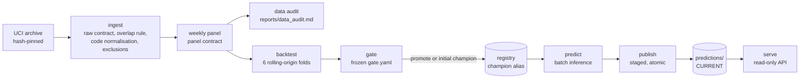

# Architecture

How forecastgate turns a pinned public dataset into a gated model and served forecasts.
Design decisions and their reasons are in [design.md](design.md); this document describes
the system as implemented. Every behaviour named here has a test or a captured run in
[failures.md](failures.md).

## Data flow



| Stage | Module | Output | Guard |
|---|---|---|---|
| Ingest | `ingest.py` | transactions, sales, exclusion counts | SHA-256 pin; Pandera raw contract per sheet; sheet overlap must be an exact multiset match |
| Panel | `panel.py` | product-week series, complete weeks, zero-transaction weeks | Pandera panel contract; missing values only in zero-transaction weeks |
| Universe | `universe.py` | products for a cutoff | computed from data up to the cutoff only; at least 50 products |
| Features | `features.py` | origin features, training and inference rows | windows end at the origin; training labels need `t + h <= T` |
| Backtest | `backtest.py`, `metrics.py` | scored rows, report | recipes see only `Panel.truncated(T)`; zero-transaction target weeks stop the run |
| Gate | `gate.py` | decision with per-criterion results | full-data runs need `gate.yaml` committed and unchanged; config must match it |
| Registry | `registry.py` | model versions, `champion` alias, decision log | model files checked against registered SHA-256 on load |
| Publication | `publish.py` | `predictions/<id>/`, `CURRENT` | prediction contract in staging; lock; same identity with new content refused |
| Serving | `serving.py`, `api.py` | HTTP responses | per-request integrity and freshness checks; 503 on refusal |

## Boundaries: training, batch inference, serving

The three stages share no in-memory state; they meet only through files with checksums.

- **Training** (`forecastgate gate`) reads the archive, backtests every recipe, applies
  the frozen gate and writes to the registry. It is the only writer of the registry.
- **Batch inference** (`forecastgate predict`) reads the registry's champion and the
  archive, and is the only writer of `predictions/`. It refuses a champion fitted on
  different input (data hash or input hash), so it never serves a model trained on
  other data.
- **Serving** (`forecastgate serve`) reads `predictions/` and writes nothing. It never
  imports training code paths and never falls back to an older artifact.

`forecastgate reproduce` chains audit, training and batch inference. A gate rejection
(exit 10 from `gate`) is an expected outcome there: it is logged, and publication
continues with the current champion. Any other failure stops the run.

## Recipes and the truncated panel

A recipe (`recipes.py`) is a method plus its configuration: `naive`, `ma4` (4-week
moving average) or `lgbm` (global LightGBM, direct multi-horizon, Tweedie objective,
fixed parameters, single-threaded and deterministic). Every recipe is fitted on
`Panel.truncated(T)`, a panel object that contains nothing after the cutoff, so a recipe
cannot read the future even through a bug in its own code. Baselines are first-class
recipes: they can be the champion and their artifacts carry the same metadata.

## Registry

A file-based JSON registry (`artifacts/<source>/registry/`), chosen over MLflow because
the job here is versions, an alias, lineage and checksums, and two of the three recipes
are parameter-free baselines.

```
registry.json          versions and the champion alias, replaced atomically
decisions.jsonl        one line per gate run: decision, failed criteria, champion before/after
models/v<N>/           fitted.json plus levels.csv or model.txt
```

Each version records recipe, parameters, config hash, data hash, input hash (prepared
panel, universe, horizons), gate SHA-256, freeze commit and the commit that registered
it. On an empty registry the gate registers the best single baseline as the initial
champion; a promoted candidate is refitted at the publication cutoff and becomes
champion; a champion fitted on other input is refitted under its own recipe.

## Publication protocol

```
predictions/.lock                one publisher at a time (exclusive create)
predictions/.staging/<id>-<n>/   assembled and validated, never read by serving
predictions/<id>/                predictions.csv + manifest.json, committed by rename
predictions/CURRENT              identity to serve, swapped with os.replace
```

Identity is a hash of cutoff, model version, recipe config hash, archive hash and input
hash. Predictions are a CSV with a fixed byte format (UTF-8, LF, fixed columns and
order, ISO dates, `%.6f`), so the content hash is stable across platforms. A rerun with
the same identity and content is a no-op; the same identity with different content is
refused; a new model or input is a new artifact. A crash before the rename leaves only
staging; a crash between the rename and the pointer swap is repaired by rerunning.

## Determinism and provenance

- Reports hold deterministic content only; run details go to `reports/provenance.json`,
  keyed by report file, with the commit and `git_dirty` captured at command start.
- The full-data `data_audit.md` and `backtest.md` regenerate byte-identically across runs,
  on Windows and in the Linux image, and the published artifact identity is the same on
  both (`dd0f89d8f03e9061`).
- The parsed workbook is cached as Parquet keyed by the archive hash and re-validated
  against the raw contract on every read.

## Docker image and its tradeoff

One image runs every command. It carries git metadata so the gate freeze is verified
inside the container by the same code path as in a checkout. A discarded build stage
reads the build context's `.git` and passes on only `HEAD`, objects, refs, packed refs and
the index, with a freshly written config (`core.filemode=false`, so a Windows build
context does not make every file look modified). The original config, reflogs and hooks
reach no layer of the final image; a scan of every decompressed layer for planted
credentials finds none (failures.md, demonstration 7). The build context also excludes
downloaded data, caches, local registries, artifacts and credential files.

The tradeoff, accepted for a local portfolio project: a larger image that contains the
repository history, in exchange for a freeze check identical to the checkout's. A
production image would ship a signed freeze attestation and no history.

## CI

`.github/workflows/ci.yml` runs Ruff, mypy, pytest, the fixture `reproduce` and
`backtest` locally and in the image, and a manual `full-data-docker` job that requires
the regenerated reports to equal the committed ones. It is configured but has not run
on GitHub yet; everything above was verified locally.
